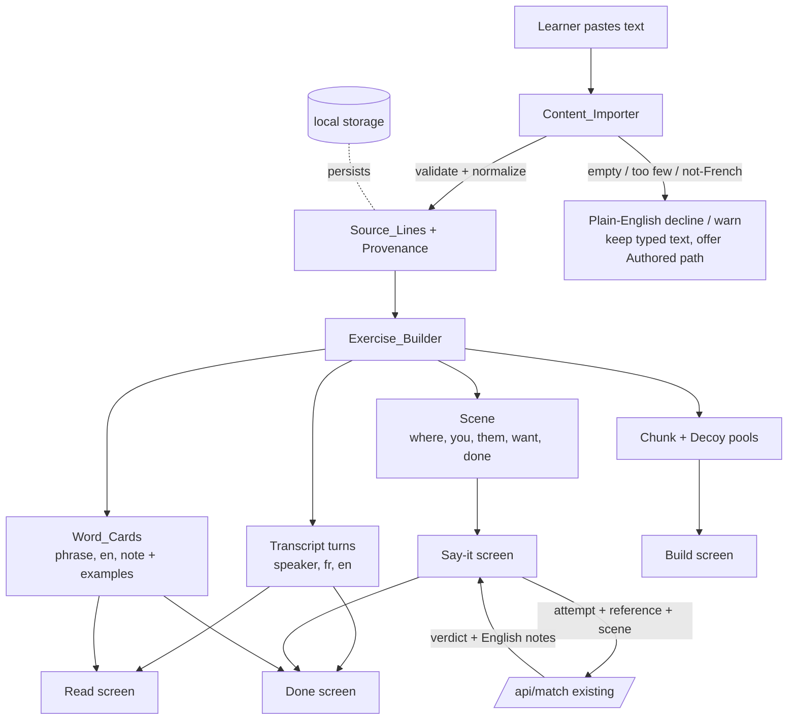

# Design Document

## Overview

This design describes **content-to-exercise generation**: two new client-side components —
**Content_Importer** and **Exercise_Builder** — that let a learner paste their own French and
have the app turn it into the exercises it already runs (Read → Build → Say it → Done).

The design is built around one hard constraint carried over from the PRD (§16.4 / §17.2) and
pinned down in the requirements (Requirement 10): **no invented French**. The app never writes,
translates, paraphrases, or auto-corrects French. It only *selects, segments, and re-presents*
French that a human — the product owner (Authored_Content) or now the learner (Learner_Content) —
already wrote. Everything the two new components emit is either a verbatim slice of a learner
string or English the app owns and labels as its own.

The second organising idea is **shape compatibility**. The existing Read/Build/Say-it/Done screens
consume four data shapes defined by the prototype: `turns` (`[speaker, fr, en]`), `PHRASES`
(`{phrase: {en, note}}`), `SCENE` (`{where, you, them, want, done}`), and the chip pool (an array
of chunk strings). Exercise_Builder's job is to emit exactly those shapes so the render layer needs
**no learner-built-specific branch** (Requirement 11.2). This is why the components are modelled as
*producers of existing shapes* rather than as a parallel rendering path.

### Source material this design builds on

- **Prototype data shapes and logic** (`weekend-mission-prototype.html`): `WEEKENDS[key] =
  {label, en, turns:[[speaker, fr, en], …]}`, `PHRASES = {phrase: {en, note}}`, example gathering
  via `usesOf(phrase)`, `SCENE = {where, you, them, want, done}`, the `chunk(sentence)` splitter
  (`split on (?<=[,.!?…])\s+`, then group into 2–3 word pieces), `poolFor(turnIndex)` (target chunks
  + up to 2 decoys from *other* content), and `judge(said, target)` which calls `POST /api/match`.
- **Matcher contract** (`server.js`): request `{scene, accepted:[reference], utterance, vocab:[…]}`,
  response `{verdict:"works"|"thin"|"missed"|"unchecked", index, note, suggest:[…], structure}`.
  The server already discards any model-invented French (`suggest` is filtered to the supplied
  `vocab`; `index` is range-checked; unknown verdicts become `thin`; failures become `unchecked`).
- **PRD constraints**: no runtime French generation (§13.3), show ability not score (§4.1, §16.8),
  five-part scene (§6.3), local-only storage (§13.5), empty-state keeps Authored_Content working (§6.1).

## Architecture

The feature is a client-side pipeline inserted *before* the existing render layer. Nothing new
touches the network except the existing matcher call, which is unchanged in contract.



### Boundaries and responsibilities

- **Content_Importer** owns *provenance-in*: it is the only place raw learner text enters the
  system. It validates, segments, trims, and stamps every Source_Line with `provenance:"learner"`.
  After it runs, no raw text flows forward un-attributed.
- **Exercise_Builder** owns *shape-out*: it is a set of pure transforms from `Source_Line[]` into
  the four existing shapes. It never invents French; if a transform cannot complete without
  inventing French, it emits the empty/degraded form defined per requirement (zero word-cards,
  decoy-free Build, neutral default Scene) rather than fabricating.
- **Render layer** is unchanged. It receives the same shapes whether the data came from
  Authored_Content or Exercise_Builder.
- **Matcher** is unchanged. The Say-it path sends only `{scene, accepted:[learnerReferenceLine],
  utterance, vocab}` and discards any generated French in the response (Requirement 8.4, 12.4).

### Why pure transforms

Content_Importer and Exercise_Builder are deliberately pure functions over strings and plain data
(no I/O, no network, no DOM). This is what makes the no-invented-French property testable: a test
can assert that **every French string in the output is a substring of the concatenated input**, for
any input. It also satisfies Requirement 12.1 (segmentation/chunking/selection/scene run on the
client with no network request carrying Learner_Content).

## Components and Interfaces

### Content_Importer

```
importContent(rawText: string, options?: { defaultSpeaker?: string })
  -> ImportResult

type ImportResult =
  | { ok: true;  sourceLines: SourceLine[]; truncated: boolean }
  | { ok: false; reason: "empty" | "too_few" | "not_french";
      message: string;             // plain English, learner-facing
      sourceLineCount: number;     // for "too_few"
      preservedText: string;       // the learner's text, echoed back verbatim
      requiresConfirmation?: boolean } // true only for "not_french"
```

Responsibilities (Requirements 1, 2, 3):
- Enforce the 5,000-character cap; when exceeded, set `truncated:true` and keep only the leading
  5,000 characters (Requirement 1.6) — never fail silently.
- Detect speaker-prefixed lines: a leading label of 1–20 characters followed by `:` or `-`
  (Requirement 1.3). A label that is empty/whitespace/separators-only ⇒ unattributed line
  (Requirement 1.5).
- When no line is speaker-prefixed, attribute every Source_Line to a single default learner speaker
  (Requirement 1.4).
- Segment on sentence-ending punctuation (`.`, `!`, `?`, `…`) and explicit line breaks
  (Requirement 2.2), preserving order (Requirement 2.1).
- Trim outer whitespace only; never alter internal characters, accents, or contractions
  (Requirements 2.3, 2.5, 10.4). Discard whitespace-only segments (Requirement 2.6).
- Stamp `provenance:"learner"` on every Source_Line (Requirement 2.4).
- Decline (`ok:false`) for empty/whitespace input (3.1) or fewer than 2 Source_Lines (3.2);
  warn with `requiresConfirmation:true` when no French-relevant characters are present (3.3);
  always echo `preservedText` so the learner can edit (3.4). The caller keeps the Authored_Content
  path available (3.5, 11.3).

### Exercise_Builder

```
buildExercises(sourceLines: SourceLine[]) -> BuiltSession

type BuiltSession = {
  transcript: Turn[];        // [speaker, fr, en]  — Read
  wordCards: WordCardMap;    // { phrase: { en, note, examples } } — Read/word-card
  scene: Scene;              // { where, you, them, want, done } — Say-it framing
  buildFor(index): Pool;     // target chunks + decoys — Build
}

buildTranscript(sourceLines) -> Turn[]
selectWordCards(sourceLines) -> WordCardMap          // 0..12 cards
chunksOf(sourceLine) -> string[]                     // reuse existing chunk()
buildPool(targetIndex, sourceLines) -> { target: string[]; pool: string[] }
buildScene(sourceLines) -> Scene                     // English only; neutral default fallback
```

Responsibilities (Requirements 4–7):
- `buildTranscript`: one turn per Source_Line in order, `fr` verbatim, `en` empty unless the learner
  paired an English line; never invent a translation (Requirements 4.1, 4.2, 4.4).
- `selectWordCards`: pick 1–12 candidate phrases, each occurring verbatim in ≥1 Source_Line; set the
  French phrase to exact text; attach 1–3 examples drawn from the learner's own Source_Lines labelled
  with origin; omit gloss when none supplied; produce zero cards rather than fabricate (Requirement 5).
- `chunksOf`: reuse the existing `chunk()` splitter unchanged (Requirement 6.1).
- `buildPool`: target chunks from the selected Source_Line; decoys drawn only from *other*
  Source_Lines in the same content; exclude any decoy whose trimmed, case-sensitive, accent-preserving
  text equals a target chunk; include 0–4 decoys (pool ≤ target + 4); if no other Source_Line exists,
  build from target chunks alone with no Authored or generated decoys (Requirement 6).
- `buildScene`: five English parts; if the five parts cannot be populated from concrete references,
  emit a neutral default Scene whose success condition is "keep the conversation going"; never copy
  or translate Learner_Content French into the Scene (Requirement 7).

### Say-it matcher adapter (reuses existing `judge`)

```
judgeLearnerAttempt(utterance, referenceSourceLine, scene) -> Verdict
```
Sends `{ scene, accepted:[referenceSourceLine], utterance, vocab }` to `POST /api/match`, maps the
response verdict to `{works|thin|missed|not checked}`, discards any generated French, and reveals the
learner's own `referenceSourceLine` labelled as a reference (Requirement 8). On any unavailability it
returns `not checked` and lets the learner self-judge (Requirement 8.6).

### Persistence

```
saveLearnerContent(sourceLines) / loadLearnerContent() -> local storage only
```
Learner_Content and derived session state live in client-side local storage only; cleared storage ⇒
first-run behavior offering the Authored_Content path (Requirement 12.2, 12.5).

## Data Models

```
SourceLine = {
  speaker: string | null,   // label (1..20 chars) or null when unattributed/default
  fr: string,               // verbatim learner French, outer-trimmed only
  en: string,               // learner-supplied English, else "" (never invented)
  provenance: "learner",    // always "learner" for imported content
  index: number             // position within Learner_Content (0-based)
}

Turn = [speaker: string, fr: string, en: string]   // matches WEEKENDS[key].turns

WordCard = {
  phrase: string,           // verbatim slice of a Source_Line
  en: string | null,        // app-authored English gloss, or null when none
  note: string | null,      // app-authored English note, or null
  examples: Array<{ fr: string; en: string; src: string }>  // 1..3, fr verbatim, src = speaker+position
}
WordCardMap = { [phrase: string]: WordCard }

Scene = {                    // matches prototype SCENE; all values English
  where: string; you: string; them: string; want: string; done: string
}

Pool = { target: string[]; pool: string[] }   // chunk strings; pool.length <= target.length + 4

Verdict = {
  kind: "works" | "thin" | "missed" | "not checked";
  note: string;             // English
  reference: string;        // the learner's own Source_Line, labelled as reference
}
```

**Provenance model.** Every French string rendered in a learner-built exercise is traceable to a
Source_Line (`provenance:"learner"`) or to Authored_Content. The practical invariant the
transforms maintain: *every French string Exercise_Builder emits is a substring of some input
Source_Line's `fr`*. English fields (`en`, `note`, Scene parts, coach notes) are app-owned and never
presented as the learner's French.

## Correctness Properties

*A property is a characteristic or behavior that should hold true across all valid executions of a
system — essentially, a formal statement about what the system should do. Properties serve as the
bridge between human-readable specifications and machine-verifiable correctness guarantees.*

These properties apply well to this feature because Content_Importer and Exercise_Builder are pure
functions over strings and plain data, with strong universal invariants (verbatim preservation,
provenance, round-trips, size bounds). The following were derived from the prework analysis of every
acceptance criterion.

### Property 1: Verbatim French — the no-invented-French master invariant

*For any* Learner_Content and the full `BuiltSession` derived from it, every French string the
system emits — each Transcript turn's `fr`, every Word_Card `phrase`, every Word_Card example `fr`,
every target Chunk, and every Decoy Chunk — is an exact character-for-character slice of some input
Source_Line's `fr` (accents, casing, and contractions preserved), with no character added, removed,
substituted, or corrected. The system never emits a French string that is not such a slice.

**Validates: Requirements 2.3, 2.5, 4.4, 5.2, 10.1, 10.2, 10.4**

### Property 2: Source_Lines are non-empty and outer-trimmed

*For any* Learner_Content, every produced Source_Line's `fr` satisfies `fr === fr.trim()` and
`fr.length > 0`; no Source_Line is empty or whitespace-only, and no outer whitespace survives while
internal characters are left unchanged.

**Validates: Requirements 2.5, 2.6**

### Property 3: Provenance is stamped on every Source_Line

*For any* accepted Learner_Content, every produced Source_Line carries `provenance === "learner"`.

**Validates: Requirements 2.4**

### Property 4: Input length cap with honest truncation

*For any* input string, the Content_Importer processes at most the leading 5,000 characters, and the
result's `truncated` flag is `true` exactly when the input exceeds 5,000 characters; input over the
limit is never failed silently.

**Validates: Requirements 1.6**

### Property 5: Speaker attribution

*For any* line that begins with a label of 1–20 non-separator characters followed by `:` or `-`, the
produced Source_Line's `speaker` equals that label and its `fr` equals the trimmed remainder; *for
any* line whose label is empty, whitespace, or separator-only, the whole line becomes an unattributed
Source_Line (`speaker === null`, never an empty string); and *for any* content with no
speaker-prefixed line, all Source_Lines share one default learner speaker.

**Validates: Requirements 1.3, 1.4, 1.5**

### Property 6: Formatting-tolerant acceptance

*For any* input consisting of French sentences, line breaks, and common punctuation that yields at
least 2 Source_Lines, the Content_Importer accepts it (`ok === true`) rather than rejecting it for
formatting alone.

**Validates: Requirements 1.2**

### Property 7: Reject path reports honestly and preserves input

*For any* input that is declined or warned about, the result echoes the learner's exact typed text
in `preservedText` (`preservedText === rawText`); and *for any* input yielding fewer than 2
Source_Lines, the result is `ok === false` with `reason === "too_few"` and a `sourceLineCount`
equal to the number of Source_Lines actually found.

**Validates: Requirements 3.2, 3.4**

### Property 8: Transcript shape, order, and English handling

*For any* Source_Line list, `buildTranscript` produces one turn per Source_Line in the same order,
where each turn's French equals the corresponding Source_Line's `fr` verbatim and each turn's English
equals the learner-supplied English for that line or `""` — never an invented translation.

**Validates: Requirements 4.1, 4.2**

### Property 9: Word-card selection is bounded, verbatim, and gloss-honest

*For any* Source_Line list, `selectWordCards` returns between 0 and 12 cards; every card's `phrase`
occurs verbatim in at least one Source_Line; every card carries between 1 and 3 examples each drawn
verbatim from a Source_Line and labelled with its origin; and any card for which the learner supplied
no gloss has `en === null` (phrase and examples still present, no French fabricated).

**Validates: Requirements 5.1, 5.3, 5.5**

### Property 10: Chunking reconstructs the line from verbatim slices

*For any* Source_Line, the ordered word sequence of its target Chunks (produced by the existing
`chunk` splitter) equals the word sequence of the Source_Line, and every Chunk is a verbatim slice
of that Source_Line.

**Validates: Requirements 6.1**

### Property 11: Decoy provenance, exclusion, and pool-size bound

*For any* Source_Line selected for Build within a Learner_Content, every Decoy Chunk is a chunk of a
*different* Source_Line in the same Learner_Content (never Authored or generated); no Decoy equals a
target Chunk under trimmed, case-sensitive, accent-preserving comparison; the pool includes between 0
and 4 Decoys so that `pool.length <= target.length + 4`; and when no other Source_Line exists, the
pool equals the target Chunks alone with zero Decoys.

**Validates: Requirements 6.2, 6.3, 6.4, 6.6**

### Property 12: Scene is complete and contains no learner French

*For any* Source_Line list, `buildScene` returns a Scene whose five parts (`where`, `you`, `them`,
`want`, `done`) are all non-empty, and no Scene part contains any Source_Line's French as a substring
(the Scene is app-authored English, never copied or translated learner French).

**Validates: Requirements 7.1, 7.2, 7.5**

### Property 13: Matcher verdict mapping stays inside the fixed set

*For any* matcher response, the presented Verdict's `kind` is exactly one value from
`{works, thin, missed, not checked}`; a verdict value outside the matcher's known set maps to
`not checked`; any French string the matcher generates is discarded so the only French presented is
the learner's own reference Source_Line, and that reference equals the input reference verbatim and is
labelled as a reference, never as a corrected or generated answer.

**Validates: Requirements 8.2, 8.3, 8.4, 8.5**

### Property 14: Done screen pairs honestly and shows no scores

*For any* session attempt log, the Done screen pairs each submitted attempt with the reference
Source_Line recorded for that attempt's exercise identity; every French string shown on Done is
verbatim Learner_Content or a learner's own attempt (no System-generated French); and the Done output
contains no score, fraction, percentage, numeric count of attempts or correct answers, level, or
streak.

**Validates: Requirements 9.1, 9.2, 9.3, 9.4**

### Property 15: Builder output conforms to the existing shapes

*For any* Source_Line list, `buildExercises` produces a `transcript` of `Turn` triples
`[speaker, fr, en]`, a `wordCards` map of `{phrase: {en, note, examples}}`, a `scene` of
`{where, you, them, want, done}`, and `buildFor(index)` pools of chunk strings — matching the shapes
the existing Read, Build, Say-it, and Done screens already consume, with no learner-built-specific
render path.

**Validates: Requirements 11.2**

### Property 16: Learner_Content never leaves the device except in the restricted matcher payload

*For any* import-and-build run, no network request is made carrying Learner_Content (segmentation,
chunking, word-card selection, and scene construction are pure and client-side); and *for any* Say-it
attempt, the matcher request body contains only the attempt text, the single reference Source_Line
(`accepted:[reference]`), the Scene framing, and vocab — no other Learner_Content.

**Validates: Requirements 12.1, 12.3, 12.4**

## Error Handling

The pipeline fails toward the learner's own material and plain English, never toward invented French.

- **Empty or whitespace-only input** (Requirement 3.1): `importContent` returns
  `{ ok:false, reason:"empty" }` with a plain-English message that some text is needed; typed text is
  preserved for editing.
- **Too few Source_Lines** (Requirement 3.2): `{ ok:false, reason:"too_few", sourceLineCount }` with a
  plain-English message that more material is needed; the found count is reported honestly.
- **Does not look like French** (Requirement 3.3): `{ ok:false, reason:"not_french",
  requiresConfirmation:true }`; the learner must explicitly confirm before the build proceeds.
- **Over-length input** (Requirement 1.6): truncate to the leading 5,000 characters, set
  `truncated:true`, and inform the learner — never silent failure, never silent full acceptance.
- **A build step would require invented French** (Requirement 10.5): the step halts and emits its
  defined degraded form — zero Word_Cards, a decoy-free Build pool, or the neutral default Scene —
  leaving already-recorded learner material unchanged and surfacing a plain-English reason. No step
  ever fabricates French to avoid an empty result.
- **Matcher unavailable** — no API key, network/endpoint error, or timeout (Requirement 8.6): present
  the `not checked` Verdict, reveal the learner's own Source_Line, and state plainly in English that
  automated feedback is unavailable so the learner can self-judge. A failure is never reported as
  `missed` (consistent with the existing server behavior).
- **Unexpected matcher verdict or injected French** (Requirements 8.4, 8.5): coerce unknown verdicts
  to `not checked` and discard any generated French before rendering.
- **Decline always leaves a working product** (Requirements 3.5, 11.3): the Authored_Content path
  stays available on every decline and when no Learner_Content exists.

## Testing Strategy

PBT **is** appropriate here: Content_Importer and Exercise_Builder are pure
functions over strings and plain data with strong universal invariants (verbatim preservation,
provenance, round-trips, bounds). The matcher adapter's mapping logic is also pure given a response,
so it is tested with generated responses and a mocked endpoint. UI-parity and flow concerns
(Requirements 1.1, 3.5, 4.3, 5.4, 6.5, 7.4, 10.3, 11.1, 11.3, 11.5, 12.2, 12.5) are covered by
example/snapshot and integration tests rather than property tests.

### Property-based tests (the 16 properties above)

- Use a property-based testing library for the target language (JavaScript: **fast-check**). Do not
  implement property-based testing from scratch.
- Each property is implemented as a **single** property-based test running a **minimum of 100
  iterations**.
- Each test is tagged with a comment referencing its design property, in the format
  `Feature: content-to-exercise, Property <number>: <property text>`.
- Generators:
  - **Learner_Content generator**: multi-line French-ish text mixing accented characters
    (`é à ç ô î …`), casual contractions (`t'as`, `j'ai pas`), the sentence terminators
    `. ! ? …`, line breaks, optional speaker prefixes (`Label:` / `Label-`), and degenerate labels
    (empty, whitespace-only, separator-only) to exercise Property 5.
  - **Edge inputs**: empty/whitespace-only strings, single-sentence inputs (Property 7, 11 single-line
    case), over-5,000-character strings (Property 4), and non-Latin-only strings (not-French path).
  - **Matcher-response generator**: objects with in-set and out-of-set `verdict` values and injected
    French strings in `note`/`suggest`/`structure` to exercise Property 13.
- The master containment check (Property 1) is reused as an assertion helper across Properties 8–12.

### Example / integration tests

- **Importer UI** presents a text input and keeps the Authored path on decline (1.1, 3.5).
- **Read** renders a learner-built Transcript through the same word-card affordance and English toggle,
  and the empty-English toggle shows a plain-English "no translation" note (4.3, 4.5).
- **Word-card** gloss/note render in the English region, labelled as the app's (5.4); zero-candidate
  input yields zero cards (5.6).
- **Build** uses the existing up-to-three-attempts and reveal behavior (6.5).
- **Scene** renders via the existing five-part layout; reference-poor content yields the neutral
  default Scene (7.3, 7.4).
- **Say-it** integration against a mocked `/api/match` verifies the request payload shape (8.1) and
  the four unavailability paths (8.6).
- **Done** empty-session message appears with no fabricated evidence (9.5).
- **Flow parity**: a learner-built session advances through Set up → Choose → Read → Build → Say it →
  Done in the same order, and Authored_Content sessions behave identically (regression) (11.1, 11.4
  Authored half, 11.5).
- **Privacy/persistence**: Learner_Content writes only to local storage; cleared storage yields
  first-run behavior offering the Authored path (12.2, 12.5).

### Unit tests

Focused unit tests cover concrete examples and boundaries that complement the properties: a known
speaker-prefixed dialogue parsed into expected Source_Lines, a known single-line input producing a
decoy-free pool, and the exact 5,000-character boundary. Property tests carry the broad input
coverage; unit tests pin down representative, human-readable cases.
